<p align="center">
  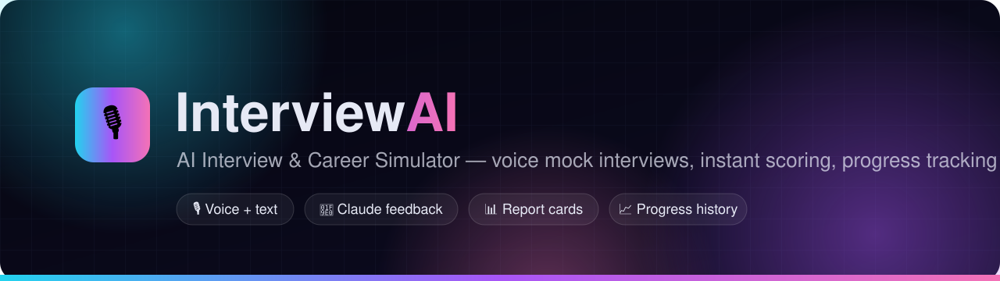
</p>

<p align="center">
  <a href="https://nextjs.org"></a>
  <a href="https://www.typescriptlang.org"></a>
  <a href="https://tailwindcss.com"></a>
  <a href="https://www.anthropic.com"></a>
  
  
  <a href="LICENSE"></a>
</p>

<p align="center">
  <b>Practise real interviews with an AI interviewer.</b> Pick a role and level, answer by <b>voice</b> or text,
  get every answer scored on <b>clarity, depth and relevance</b>, then track your progress until you're hire-ready.
</p>

<p align="center">
  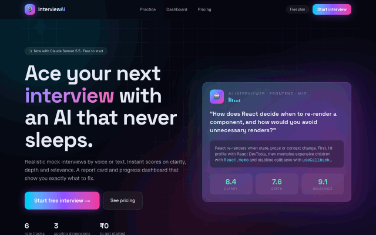
</p>

---

## ✨ Features

| | |
|---|---|
| 🎙️ **Voice-first interviews** | The interviewer reads each question aloud (Web Speech **TTS**) and live-transcribes your spoken answer (**speech-to-text**, `en-IN`). Text mode is one click away. |
| 🧠 **Claude-powered scoring** | Each answer is scored 0–10 on **clarity, depth and relevance**, with strengths, improvements and a model-answer outline — via `claude-sonnet-5-5` and forced tool-use for reliable JSON. |
| 🔁 **Adaptive questions** | With an API key, Claude generates each next question from the conversation so far (follow-ups, no repeats). |
| ⚡ **Zero-key demo mode** | No `ANTHROPIC_API_KEY`? A deterministic, explainable scorer and a 54-question bank take over — the whole app works offline of any AI. AI errors also fall back automatically. |
| 🎯 **6 tracks × 3 levels** | Frontend, Android, Backend, Data Analyst, Product Manager and HR/behavioural — junior, mid or senior. |
| 📋 **Report card** | Overall score, letter grade, hire signal, skill radar, top strengths, focus areas and a per-question breakdown. |
| 📈 **Progress dashboard** | Score trend chart, skill radar, practice streak, personal best, per-role averages and full history. |
| 💳 **Free vs Pro** | Landing + pricing page with plan gating (daily limit, Pro-only roles, longer sessions) and a demo checkout. |
| 🌌 **Futuristic UI** | Dark neon glassmorphism, animated gradient orbs, grid backdrop, smooth transitions, fully responsive, `prefers-reduced-motion` aware. |

## 📸 Screenshots

| Landing | Interview setup |
|---|---|
| 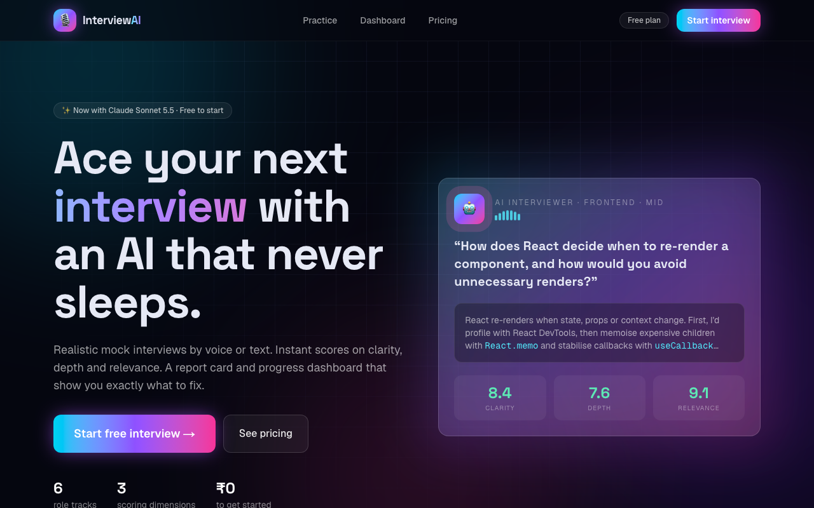 | 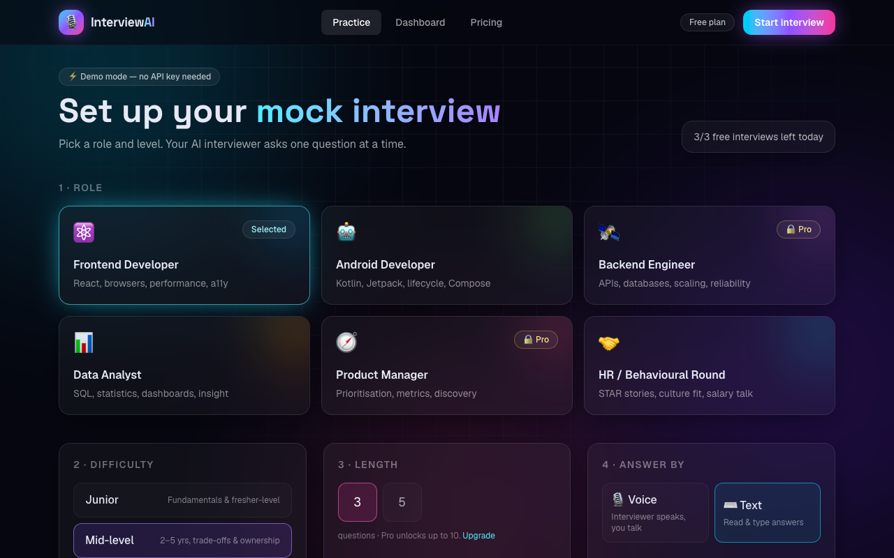 |
| **Live question** | **Instant feedback** |
| 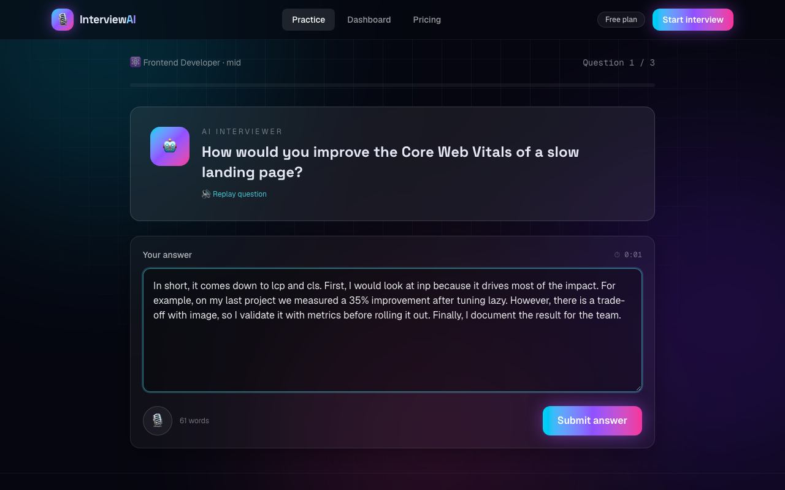 | 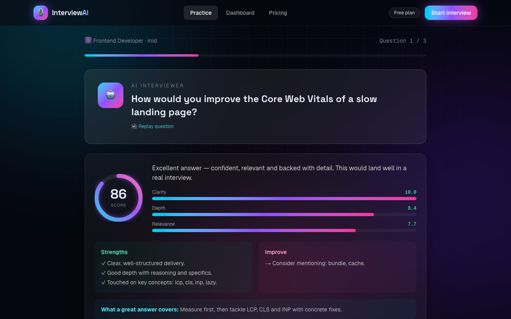 |
| **Report card** | **Progress dashboard** |
| 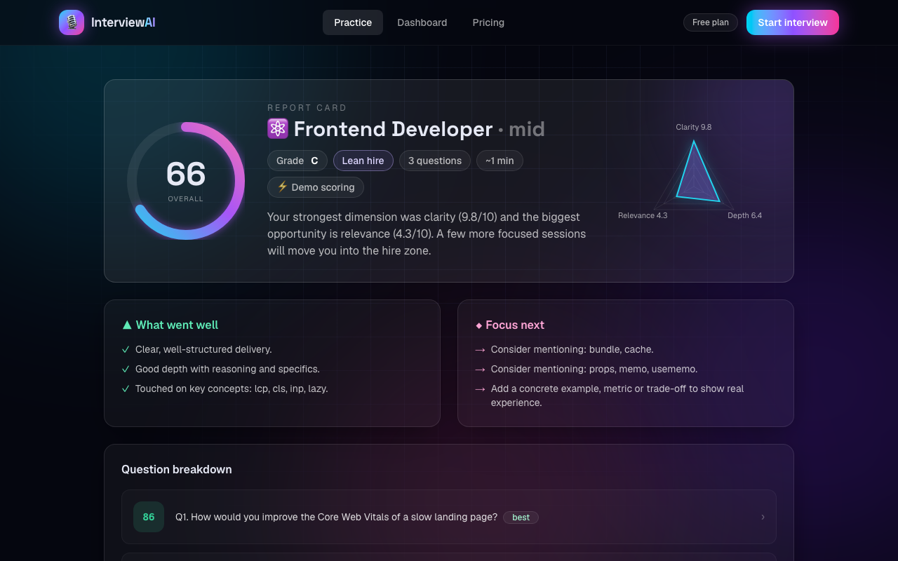 | 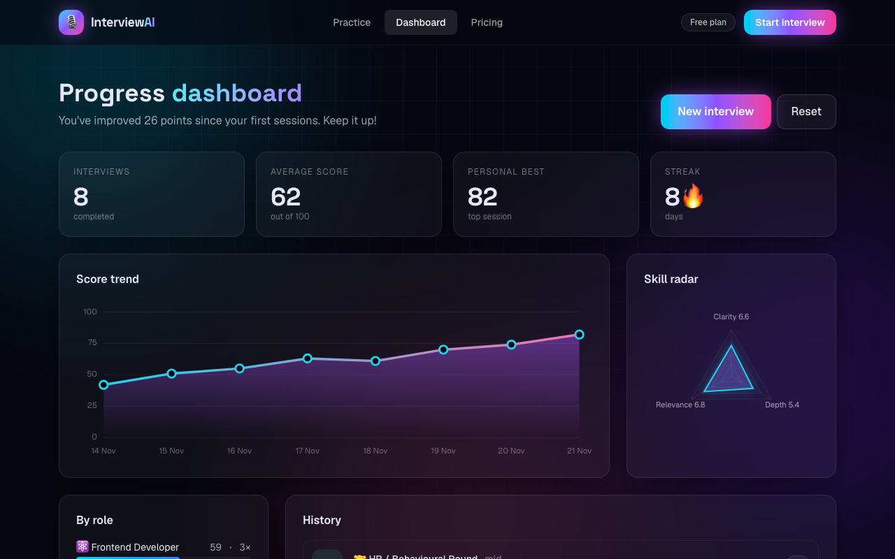 |
| **Pricing** | **Mobile** |
| 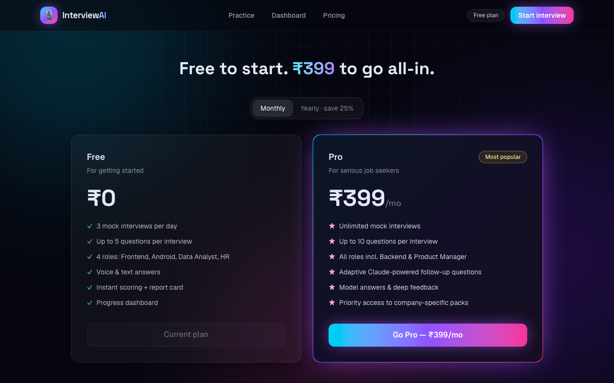 | 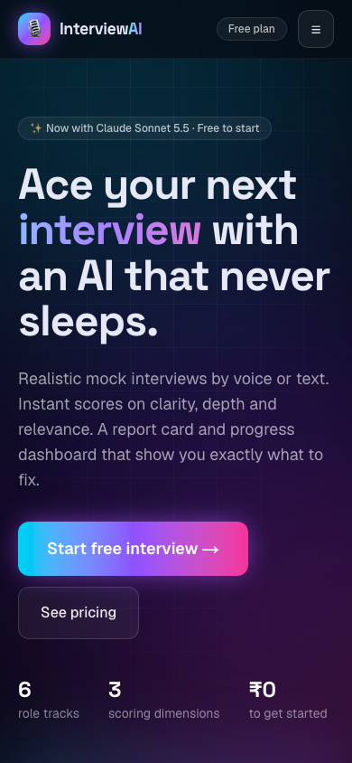 |

> All screenshots and the demo GIF are captured automatically by Playwright (`npm run docs`).

## 🏗️ Architecture

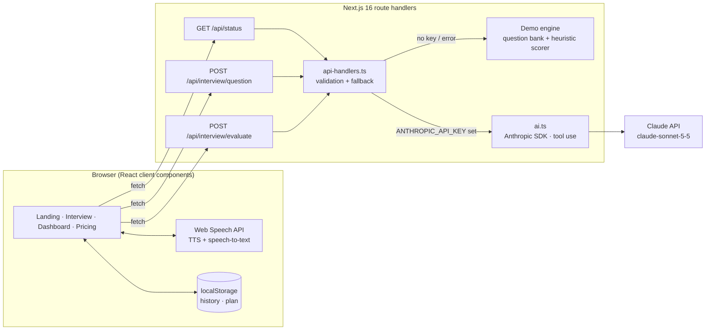

**Key design choices**

- **The API key never reaches the browser.** All Claude calls happen in route handlers; the key is read from `.env.local` at request time.
- **Forced tool use** (`tool_choice: { type: "tool" }`) makes Claude return a typed evaluation object, which is then clamped and validated by `normaliseEvaluation()` before the UI sees it.
- **Graceful degradation:** every AI path falls back to the local engine on a missing key, a network error or a malformed response, so the interview never breaks mid-session.
- **Framework-agnostic handlers** (`src/lib/api-handlers.ts`) keep the business logic unit-testable without booting Next.js.

## 🧰 Tech stack

- **Framework:** Next.js 16 (App Router, Cache Components) + React 19 + TypeScript
- **Styling:** Tailwind CSS 4, custom glassmorphism utilities, hand-built SVG charts (no chart library)
- **AI:** Anthropic TypeScript SDK → `claude-sonnet-5-5`
- **Voice:** Web Speech API (`speechSynthesis` + `SpeechRecognition`)
- **Persistence:** `localStorage` (history, plan) — no account needed
- **Testing:** Vitest (36 unit tests), Playwright (5 e2e tests in demo mode)
- **Tooling:** ESLint (next/core-web-vitals), a no-ffmpeg GIF builder (`pngjs` + `gifenc`)

## 🚀 Getting started

```bash
git clone https://github.com/BhargavKJani/ai-interview-simulator.git
cd ai-interview-simulator
npm install
npm run dev            # http://localhost:3000 — runs in demo mode out of the box
```

Enable the live Claude interviewer (optional):

```bash
cp .env.example .env.local
# then set ANTHROPIC_API_KEY=sk-ant-... in .env.local and restart `npm run dev`
```

| Script | What it does |
|---|---|
| `npm run dev` | Start the dev server |
| `npm run build` / `npm start` | Production build / serve |
| `npm run lint` | ESLint |
| `npm run typecheck` | `tsc --noEmit` |
| `npm test` | Vitest unit tests (scoring, report, history/limits, question bank, API handlers incl. mocked Claude) |
| `npm run test:e2e` | Playwright e2e in forced demo mode (first run: `npx playwright install chromium`) |
| `npm run docs` | Re-capture README screenshots + rebuild `docs/demo.gif` |

> **Voice tip:** speech-to-text works best in Chrome or Edge. Safari supports TTS; Firefox falls back to typing.

## 💰 Business model

InterviewAI is built as a **commercial MVP** for the Indian job-seeker market (freshers, campus placements, career switchers).

| | **Free** | **Pro — ₹399/mo** (₹3,591/yr, save 25%) |
|---|---|---|
| Interviews | 3 per day | Unlimited |
| Questions per interview | up to 5 | up to 10 |
| Roles | Frontend, Android, Data Analyst, HR | All roles incl. Backend & PM |
| Scoring + report card + dashboard | ✅ | ✅ |
| Adaptive Claude follow-ups & deep feedback | — | ✅ |

**Revenue streams**

1. **B2C subscriptions** — Free tier drives acquisition (SEO + campus word-of-mouth); the daily cap and locked roles convert serious seekers to Pro. ₹399 is priced below a single human mock-interview session.
2. **Company & role packs** — one-time ₹199–₹499 packs (e.g. "FAANG frontend", "TCS/Infosys HR round", "Product-based Android").
3. **B2B / campus licences** — placement cells and bootcamps buy seats with a cohort dashboard (per-seat annual pricing).
4. **Recruiter marketplace (later)** — opt-in sharing of verified report cards with hiring partners (lead-gen fee).

**Unit economics (rough):** a 5-question Pro session is ~10 Claude calls ≈ a few rupees of API cost, leaving healthy margins at ₹399/mo even for heavy users; demo-mode scoring costs nothing.

## 🗺️ Roadmap

- [x] Voice + text interviews with TTS and speech-to-text
- [x] Claude scoring (clarity, depth, relevance) + model answers
- [x] Report card, hire signal, skill radar
- [x] Progress dashboard with trends, streaks and history
- [x] Free vs Pro gating and pricing page
- [ ] Auth (Clerk/NextAuth) + cloud sync of history (Postgres)
- [ ] Razorpay / Stripe subscriptions and webhooks
- [ ] Resume upload → questions tailored to the candidate's CV
- [ ] Video mode with eye-contact and pace analysis
- [ ] Coding round with an in-browser editor and test runner
- [ ] Company-specific question packs and peer leaderboards
- [ ] Hindi and other Indian-language interviews

## 📁 Project structure

```
src/
  app/                 # routes: / · /interview · /dashboard · /pricing · /api/*
  components/          # InterviewApp, ReportCardView, Dashboard, Pricing, Charts, Nav
  lib/
    ai.ts              # Claude calls (tool use) — server only
    api-handlers.ts    # validation + AI/demo routing (unit-tested)
    scoring.ts         # demo scorer + evaluation normalisation
    report.ts          # report card aggregation
    history.ts         # localStorage history, plan limits, dashboard stats
    roles.ts           # roles, difficulties, 54-question bank
    useSpeech.ts       # Web Speech API hook
tests/unit/            # Vitest
e2e/                   # Playwright (+ docs capture spec)
scripts/make-gif.mjs   # PNG frames → docs/demo.gif without ffmpeg
```

## 📄 License

[MIT](LICENSE) © 2026 Bhargav Jani
